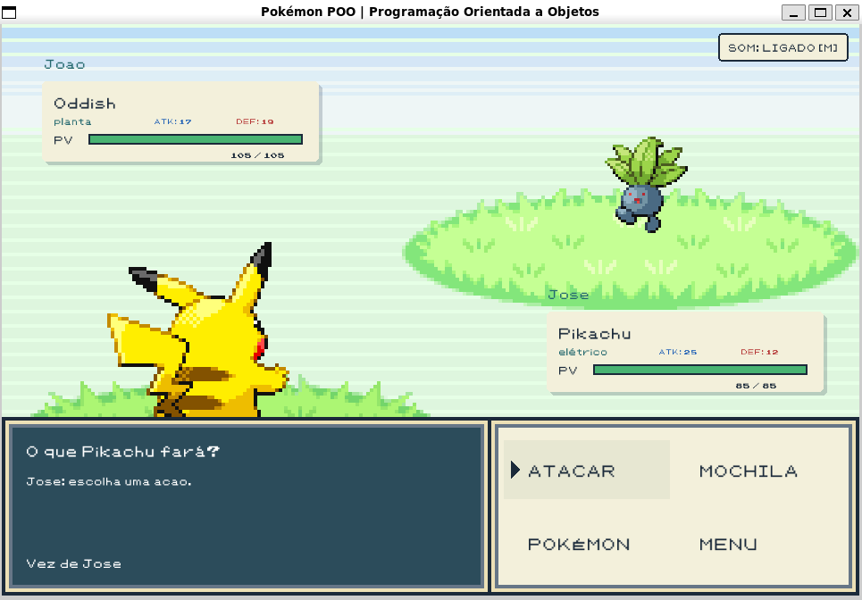

# ⚔️ Pokémon Battle System (TP2 - INF112)

Um sistema de batalha Pokémon por turnos inspirado nos jogos clássicos da franquia (*FireRed / LeafGreen*), desenvolvido em **C++11** utilizando a biblioteca gráfica **Raylib**.

---

## 📸 Demonstração



---

## 🎓 Contexto Acadêmico

Este projeto foi desenvolvido como o Trabalho Prático 2 (TP2) da disciplina de **Programação Orientada a Objetos** no curso de **Ciência da Computação** da **Universidade Federal de Viçosa (UFV)**. O objetivo principal foi consolidar e aplicar os pilares do paradigma de Orientação a Objetos (Herança, Polimorfismo, Encapsulamento e Abstração) e o gerenciamento correto de memória.

- **Instituição:** Universidade Federal de Viçosa (UFV)
- **Disciplina:** INF112 - Programação Orientada a Objetos
- **Tipo de Projeto:** Trabalho Prático Individual

---

## 🛠️ Tecnologias e Recursos Utilizados

- **Linguagem:** C++11
- **Biblioteca Gráfica/Áudio:** Raylib
- **Automação de Build:** GNU Make
- **Análise de Memória:** Valgrind
- **Mecânicas Implementadas:**
  * Sistema de batalha por turnos para equipes de 3 Pokémons
  * Tabela de vantagens e fraquezas baseada em tipos de elemento (Fogo, Água, Planta, Elétrico)
  * Golpes variados (Dano direto, Cura e Redução de Ataque do oponente)
  * Gerenciamento de inventário consumível (Itens de Cura e Fortificantes)
  * Gerenciamento dinâmico de memória sem vazamentos (*Zero Memory Leaks*)

---

## 🚀 Como Compilar e Executar

### 📋 Prerequisitos
Certifique-se de ter o compilador `g++`, `make` e a biblioteca `raylib` instaladas em seu ambiente Linux/WSL:

```bash
sudo apt update
sudo apt install build-essential libraylib-dev
```

### ⚙️ Compilação e Execução
Na raiz do repositório, execute:

```bash
make run
```

### 🔨 Outros Comandos do Makefile
* **Apenas compilar:** `make compilar`
* **Limpar arquivos do build:** `make clean`
* **Testar vazamento de memória:**
```bash
make compilar
valgrind --leak-check=full --show-leak-kinds=all ./lib/.build/pokemon
```

---

## 👤 Desenvolvedor

- **Victor Mendes (VictorMATeixeira)** - [GitHub](https://github.com/VictorMATeixeira)

---

## 📄 Licença

Este projeto é de fins estritamente acadêmicos e educacionais.
